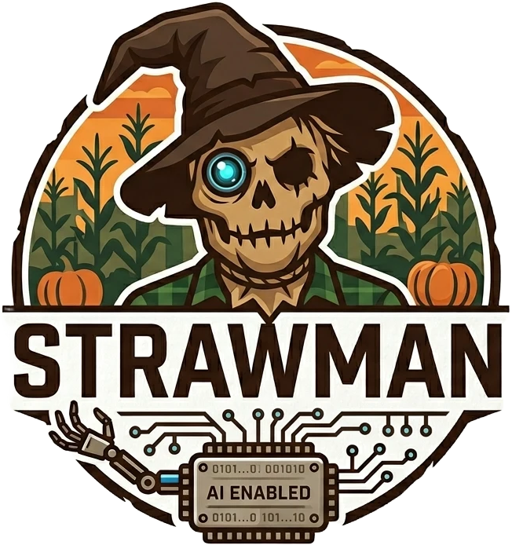
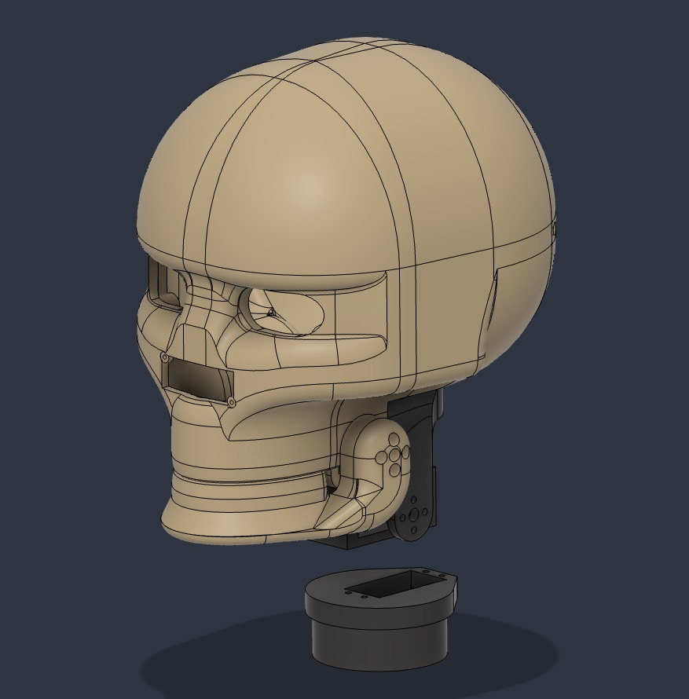

<p align="center"></p>

# StrawMan

**A talking Halloween scarecrow that watches trick-or-treaters, says something about whoever's on the porch, and talks back when they answer.**

StrawMan runs on a Raspberry Pi 5. A camera in his skull spots people, an AI writes a line about what he sees, a voice speaks it while his jaw moves in time, and a microphone listens for a reply. His head turns to follow whoever he's talking to. A web dashboard on your phone shows what he sees and lets you take over: steer his head, or type (or say) a line for him to speak.

---

## What he does

Someone comes up the walk. His head lifts, turns, settles on them, and he says something written for that moment: the group of three, the kid hanging back, the person who's already backing away. Then he listens. If they answer, he answers back, for a few turns. About **2–4 seconds** pass between spotting someone and his first word.

- **Sees people** with a pose-detection model (YOLOv8-pose), on a Raspberry Pi AI HAT+ if you have one, or on the Pi's CPU if you don't
- **Knows how far away they are** and whether they're coming or going, from an optional mmWave radar in his nose
- **Four personalities**: Friendly, Snarky, Creepy and Menacing, switchable from the dashboard mid-night. Each one tones it down for small children
- **Knows what night it is**: on October 31 he expects costumes; on other nights he treats people as neighbours and dog walkers
- **Talks** with a real voice (ElevenLabs or OpenAI), with an on-device voice as backup
- **Listens and replies**, transcribing with Whisper on the Pi, on another computer on your network, or in the cloud
- **Moves his jaw** to the loudness of what he's saying, and **tracks people** with smooth pan/tilt
- **Keeps working when the internet doesn't**: every cloud service has a backup, down to 136 pre-written lines in each personality's voice
- **Quiet hours** turn him down (and stop him looking around) late at night
- **Dashboard** with live video, a joystick, a "say this" box with voice dictation, settings, a prompt editor, servo calibration and a first-run setup wizard

---

## What you need

<p align="center"></p>

| | Part | Notes |
|---|---|---|
| **Required** | Raspberry Pi 5 | 8 GB recommended (built on a 16 GB) |
| | microSD card, 32 GB+ | |
| | USB camera | Any UVC webcam; built with a 5 MP USB camera |
| | Speaker + USB audio adapter | The Pi 5 has no headphone jack |
| | 27 W USB-C supply for the Pi | The official Pi 5 supply |
| **For the moving head** | PCA9685 16-channel servo board | **Read the warning below** |
| | 3 servos: pan, tilt, jaw | Metal-gear (MG996R class) for pan and tilt |
| | 5 V 5 A supply for the servos | Separate from the Pi's supply; grounds joined |
| | 3D-printed skull, jaw and servo mounts | Print files in [`stls/`](stls/); largest part 163 × 188 × 101 mm |
| **Optional** | USB microphone | Without one he talks but doesn't listen |
| | Raspberry Pi AI HAT+ (26 TOPS, Hailo-8) | Much smoother tracking. The 13 TOPS (Hailo-8L) version currently falls back to the CPU |
| | HLK-LD2450 mmWave radar | Distance and approach/recede, on the Pi's serial port |

Roughly **$150–250** in parts, less if you already have a Pi. The wiring is in [docs/wiring-diagram.png](docs/wiring-diagram.png). The step-by-step build, with photos, is in the StrawMan Instructable.

> **⚠️ Cheap PCA9685 boards burn out.** Many clone boards feed servo power through a tiny reverse-polarity MOSFET rated around 4 A. Ours died twice, with the servo header going dead while the board still answered over I²C. Use a genuine Adafruit board (product 815), or run the 5 V supply straight to the servo V+ rail. Also set the jaw so "closed" is *just* closed: a jaw that presses into its stop stalls the servo every time he's quiet.

### Accounts and keys

You need **one AI brain**; everything else is optional.

| | Options | Cost |
|---|---|---|
| **AI brain** (needs to understand images) | Claude (Anthropic API key), any OpenAI-compatible service (OpenAI, OpenRouter, Groq, Gemini, LM Studio), or Ollama with a vision model like LLaVA on a computer on your network | Pay-as-you-go (Claude Haiku is the default: fast and cheap); Ollama is free |
| **Voice** | ElevenLabs or OpenAI. Falls back to espeak on the Pi (installed for you) or Piper (install it yourself) | Pay-as-you-go |
| **Hearing** | Whisper on the Pi (free, offline, slower), a faster-whisper server on another computer ([`whisper-server/`](whisper-server/whisper_server.py)), or OpenAI | Free, or pay-as-you-go |

You enter keys in the setup wizard. They're stored in `.env` on the Pi, and the dashboard can replace them but never shows them.

---

## Install

Flash **Raspberry Pi OS (64-bit)**, Bookworm or Trixie, with Raspberry Pi Imager. Turn on SSH and Wi-Fi in the Imager settings. Then on the Pi:

```bash
git clone https://github.com/0xJoeMartin/StrawMan.git ~/scarecrow
cd ~/scarecrow && ./install.sh
```

`install.sh`:
- installs the system and Python packages, plus the Hailo driver if an AI HAT+ is fitted
- turns on I²C (servo board) and the serial port (radar)
- sets him up to start at boot
- turns off Wi-Fi power save and adds a watchdog that resets Wi-Fi (then reboots) if the router stops answering
- checks what's plugged in

It's safe to run again, and `./install.sh --dry-run` shows what it would change without changing anything. The first run takes 5–15 minutes and may ask to reboot.

### First run

Open `https://<the Pi's IP address>:5000` on a phone or laptop on the same network. Your browser will warn about the certificate: he makes his own, so continue anyway. The **setup wizard** walks you through:

1. A dashboard PIN
2. His brain (AI service and key)
3. His voice
4. His hearing, with a "talk to him" mic test
5. The camera
6. Head and jaw
7. His personality

Then go to **Calibrate** (`/calibrate`) to set each servo's limits by jogging it slowly. Use the **assembly pose** (every servo at 90°) when you're fitting the servo horns.

---

## Using the dashboard

| Page | What's there |
|---|---|
| **Home** (`/`) | Live camera with detection boxes, joystick, "say this" box with 🎤 dictation, personality, AI service, quiet hours, health, and a log of everything he's said and heard |
| **Settings** (`/settings`) | Voice and hearing order, API keys, camera and detection, behaviour, servo speeds and limits. Most changes apply immediately; the page tells you when one needs a restart |
| **Prompts** (`/prompts`) | Edit each personality's instructions and backup lines, with a Test button that writes a line without speaking it |
| **Calibrate** (`/calibrate`) | Servo limits, test sweeps, assembly pose |

The dashboard is HTTPS-only so your phone's browser allows the dictation mic. Every page, including the video feed, is behind the PIN.

### Tuning on the porch

- **He talks to things that aren't people**: raise *Person confidence* (Settings → Camera & detection). Turn on *Log all detections (diagnostic)* for a few minutes to see real scores in `detections.log`. On our porch people on the sidewalk scored 0.56–0.66 and junk scored up to 0.57; the setting can't go below 0.52.
- **He doesn't hear people, or hears wind**: adjust *Mic energy threshold* (Settings → Hearing). Use the wizard's mic test to see your levels.
- **He ignores people at the edge of view**: lower *Min person size*, or point the camera better. Distant people are only a few dozen pixels tall.
- **He looks somewhere you don't want him to**: narrow the pan limits on the Calibrate page.

---

## How it works

```
             ┌──────────────────── scarecrow.py ────────────────────┐
             │                  main loop + camera                  │
             └─┬────────┬────────┬────────┬────────┬────────┬───────┘
               │        │        │        │        │        │
           detector  tracker  servos    brain   speech  listener    radar
          (YOLOv8-  (who's   (PCA9685, (prompts  (voice  (mic +     (LD2450,
           pose)    who)      jaw sync) + AI)     + jaw) Silero VAD) distance)

                     web_dashboard.py — Flask over HTTPS, PIN-gated
```

1. Someone is seen for 10 frames in a row.
2. Up to 4 recent photos of them, plus a short scene description (how many people, how close, coming or going), go to the AI along with the personality's instructions.
3. While the AI thinks, he sometimes says a filler line. Then he speaks the answer.
4. He listens for up to 6 seconds. Clicks, echoes and his own jaw servo are filtered out by a voice detector before anything is transcribed.
5. If they answer, he gets a fresh photo and replies, for a few turns.

Every outside service has a fallback, tried in an order you set on the Settings page:

| | Tried first | Then | Last resort |
|---|---|---|---|
| **Brain** | The AI service you picked | — | 136 pre-written lines in each personality's voice |
| **Hearing** | faster-whisper on your network | OpenAI | Whisper on the Pi, loaded at startup |
| **Voice** | ElevenLabs | OpenAI | Piper, then espeak |

Each service logs once to the dashboard when it fails and once when it recovers.

---

## Privacy and safety

He's a camera and a microphone pointed at your neighbours' children. Know what he does with what he sees and hears.

**What leaves the Pi**
- **To your AI service:** up to 4 photos (at the camera's resolution, 640 × 480 by default) for each opening line and 1 for each reply, plus the scene description and what the person said. Check your provider's data policy. With Ollama on your own computer, nothing goes to the internet.
- **To your hearing service:** the recording of each reply, *if* that service is OpenAI. A faster-whisper server on your network, or Whisper on the Pi, keeps it local.
- **To your voice service:** the text of each line, not any audio of people.
- **Voice look** (optional, off by default) listens for talking so he can glance toward a blind spot. That audio is checked on the Pi and never recorded, transcribed or sent.

**Fully local mode:** Ollama (on a computer on your network) + Whisper on the Pi + espeak or Piper. Nothing leaves your network, though his lines and voice are noticeably weaker.

**What's kept on the Pi**
- `conversations.log`: each scene description, what he said and what people said back. Capped at 5 MB plus one old copy. Turn it off with *Log conversations* (Settings → Logging).
- The dashboard's interaction log: the last 200 events, in memory only.
- The system journal: console output, including transcripts.
- Photos are **not** saved unless you turn on *Save the photos sent to the AI* (Settings → Logging) for debugging. It keeps the last 30 conversations; turn it off again afterwards.

**Keep the dashboard on your own network.** Never port-forward it to the internet: it controls a camera, a microphone and a speaker.

**Check your local laws** on recording people, especially audio. Some places require consent, and a sign on the porch is a good idea anyway.

**Physical safety**
- Keep electrics dry and use a GFCI outlet outdoors.
- Secure him so he can't fall on anyone.
- Keep head movement slow near faces. Tilt is capped at 8°/s by default because the tilt servo lifts the whole head.
- Keep a power switch within reach.

---

## Troubleshooting

- **Logs**: `journalctl --user -u scarecrow -f` on the Pi. On some systems user-service logs only show in the system journal: `sudo journalctl _SYSTEMD_USER_UNIT=scarecrow.service -f`.
- **Restart him**: `systemctl --user restart scarecrow`, or the Restart button on the Settings page.
- **Run by hand** (stop the service first): `cd ~/scarecrow && venv/bin/python scarecrow.py --debug`. Other flags: `--persona menacing`, `--test-voice`.
- **The dashboard won't load after the Pi's IP address changed**: the certificate lists the old address. Move `scarecrow.crt` and `scarecrow.key` aside and restart; a new one is made. A DHCP reservation on your router avoids this.
- **He dropped off Wi-Fi**: the watchdog should bring him back within about 10 minutes. See what it did with `journalctl -u strawman-netwatch`.
- **Forgot the PIN**: `cd ~/scarecrow && venv/bin/python dashboard_auth.py --reset`, then reload the dashboard.
- **Tests that don't need hardware**: `python test_settings.py`, `python test_voice.py`, `python test_llm_payloads.py` and the other `test_*.py` files.

---

## Notes from building him

- **The LD2450 radar's side-to-side reading is unreliable**: several degrees of jitter, often with the wrong sign for a few frames at a time. He uses radar only for distance and approach speed, and only when its direction matches the person the camera is tracking. The camera does all the tracking.
- **Vision models invent things.** Early versions talked about dogs, scooters and pumpkins that weren't there. The prompts now say to mention only what's actually visible, and to trust the scene description about who's present.
- **Send photos from the right moment.** Taking evenly spaced frames from the last few seconds often sent the AI empty frames from before anyone arrived. He now sends only frames with a person in them.
- **A blip right after he stops talking isn't a reply.** Echo and the jaw servo used to end the listening window and trigger a "cat got your tongue?" taunt within a second.
- **Self-signed certificates need the IP address in them.** Chrome silently drops the connection after you click through the warning if the address you typed isn't listed in the certificate.
- **Flask's dev server hangs on the second TLS handshake.** The dashboard uses Python's built-in `wsgiref` with a threaded server and does the handshake in the worker thread.
- **The Pi's Wi-Fi can die while still looking connected**, with no log entries and no replies to anything. Hence the power-save change and the watchdog.

---

## Status

Built for Halloween 2026 and running on a front porch. It works end to end, and there are still rough edges. Issues and pull requests are welcome.

## License

[MIT](LICENSE), including the 3D print files. The dashboard's font and icons are Apache-2.0; see [THIRD_PARTY_NOTICES.md](THIRD_PARTY_NOTICES.md).

## Acknowledgments

Built with [Claude Code](https://claude.com/claude-code). Vision by [Ultralytics YOLOv8](https://github.com/ultralytics/ultralytics) and the [Raspberry Pi AI HAT+](https://www.raspberrypi.com/products/ai-hat/). Voices from [ElevenLabs](https://elevenlabs.io/), [Piper](https://github.com/rhasspy/piper) and [eSpeak NG](https://github.com/espeak-ng/espeak-ng). Hearing by [Whisper](https://github.com/openai/whisper), [faster-whisper](https://github.com/SYSTRAN/faster-whisper) and [Silero VAD](https://github.com/snakers4/silero-vad). Local AI with [Ollama](https://ollama.com/).
